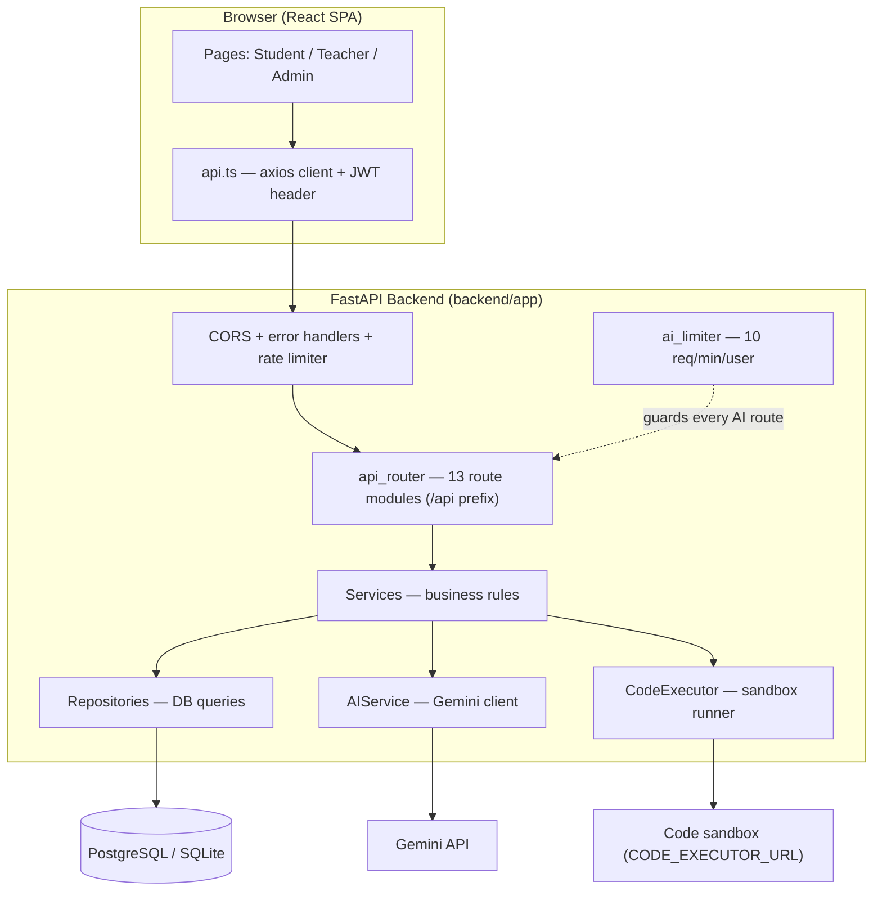
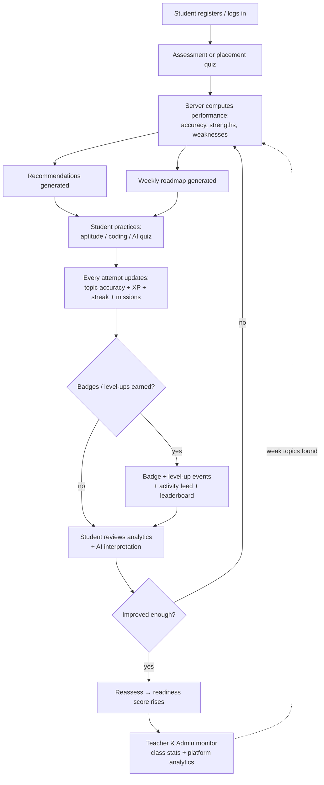
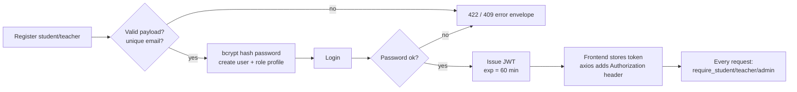
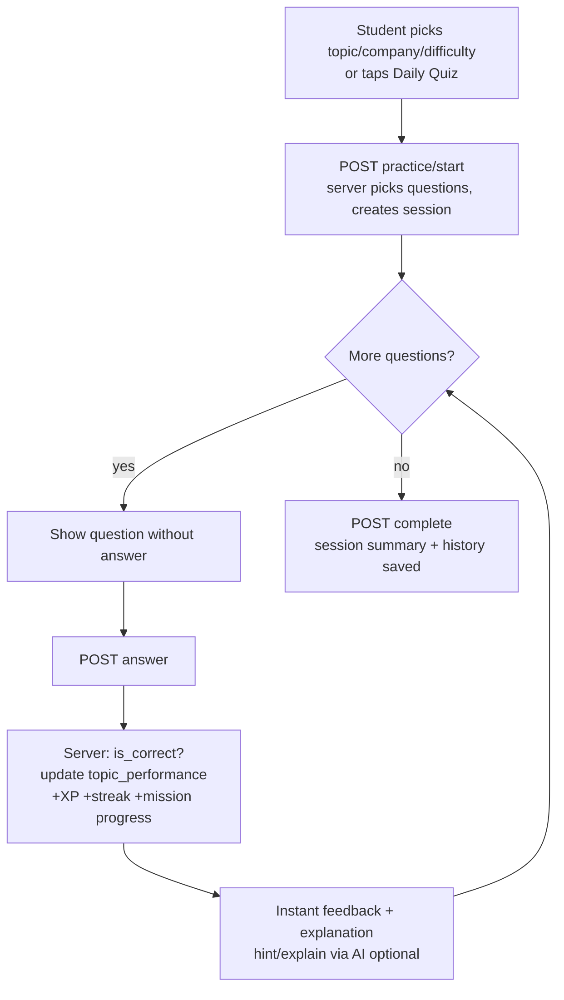
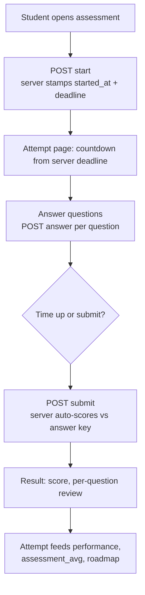
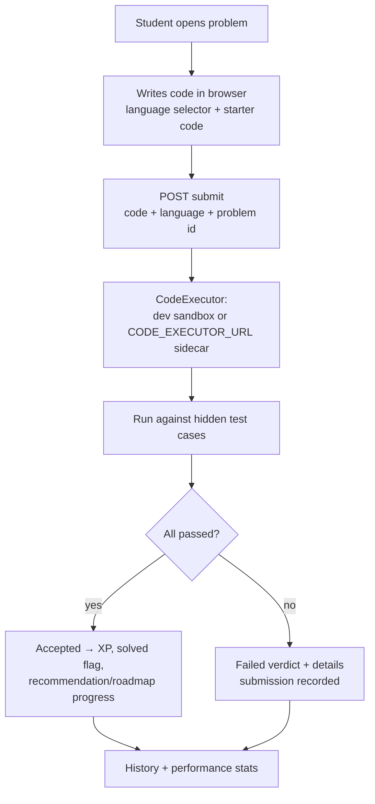
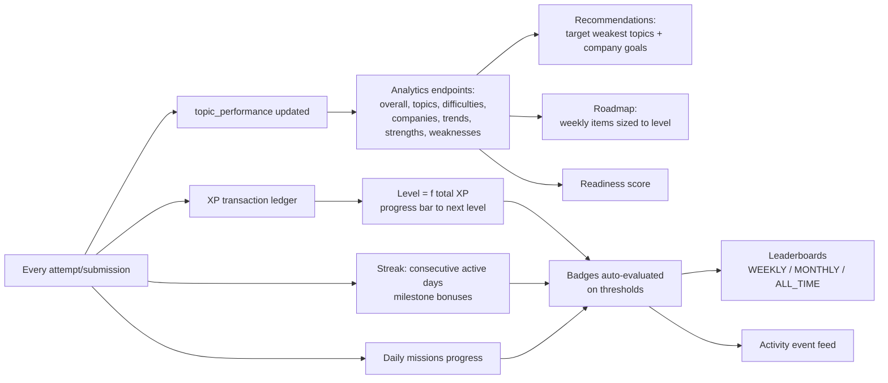
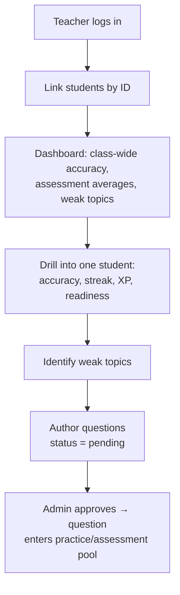
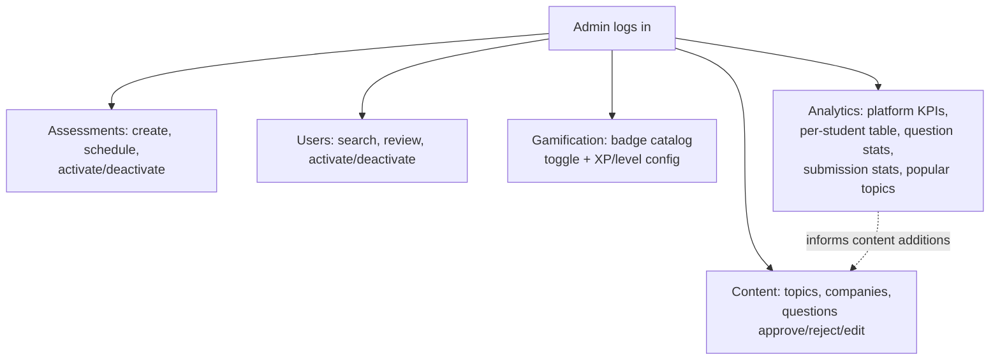
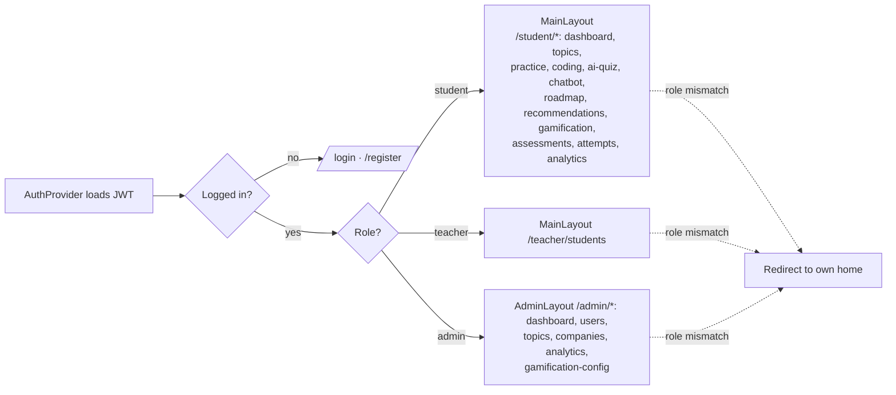

# SkillSprint — Complete System Overview

**Project:** SkillSprint — Gamified AI-powered placement-readiness and personalized learning platform
**Backend:** FastAPI (Python 3.11) · **Frontend:** React + TypeScript (Vite, Tailwind) · **Database:** PostgreSQL (SQLite in dev) · **AI:** Gemini API · **ORM:** SQLAlchemy + Alembic

This document describes every feature, the module structure, all API endpoints, the data model, and the end-to-end flows of the whole system with flow charts.

---

## 1. What SkillSprint Does

SkillSprint prepares students for company placement tests. It combines:

- **Aptitude practice** — topic-wise and company-wise question banks
- **Timed assessments** — mock tests with automated scoring
- **Coding practice** — problems judged against test cases
- **Performance analytics** — server-computed accuracy, strengths, weaknesses, trends
- **Personalization** — recommendations and a weekly adaptive roadmap
- **Gamification** — XP, levels, streaks, missions, badges, leaderboards
- **AI assistance** — explanations, hints, AI-generated questions, and a study chatbot (Gemini)
- **Three roles** — Student, Teacher, Admin — with strict RBAC

**Core design rule:** the *backend* owns all numbers (scores, XP, levels, streaks, rankings, accuracy). The *AI* only writes prose (hints, explanations, interpretations, chat replies) on top of backend-computed facts. Client-supplied metrics are never trusted.

---

## 2. High-Level Architecture



**Layering rule:** routes → services → repositories → models. Routes never touch the DB directly; services never craft SQL.

---

## 3. Module Map

### Backend (`backend/app`)

| Module | Responsibility |
|---|---|
| `api/routes/` | 13 routers: health, auth, students, teachers, admin, content, assessments, performance, recommendations, roadmap, gamification, coding, ai |
| `services/` | Business logic: assessment, content, practice, performance, recommendation, roadmap, gamification, leaderboard, coding, code_executor, ai, ai_questions, teacher, admin |
| `repositories/` | Query layer: content, performance, recommendation |
| `models/` | 31 SQLAlchemy tables (see §6) |
| `schemas/` | Pydantic request/response validation |
| `core/` | config (env), security (JWT/bcrypt), rate_limit, exceptions |
| `db/` | session + Base; `alembic/` for migrations |
| `utils/responses.py` | Standard envelope: `{success, message, data}` / `{success, message, error_code}` |
| `seed.py` | Seeds companies/topics for demo |
| `tests/` | 257 pytest tests (auth, content, practice, assessments, coding, AI, gamification, admin, teachers, security, integration) |

### Frontend (`frontend/src`)

| Area | Contents |
|---|---|
| `pages/student/` | Dashboard, Topics, Practice, Coding problems/result, Roadmap, Recommendations, Gamification, Analytics, AI Quiz, **Chatbot** |
| `pages/` (student) | Assessments, Attempt, Result, AttemptHistory, DailyQuiz, Progress, Companies, History |
| `pages/admin/` | Layout, Dashboard, Users, Topics, Companies, Analytics (students/questions/submissions/popular-topics), Gamification config |
| `pages/teacher/` | Students, Dashboard |
| `layouts/MainLayout.tsx` | Top nav shared by student + teacher |
| `services/api.ts` | Typed axios API groups: authApi, contentApi, practiceApi, assessmentApi, codingApi, performanceApi, roadmapApi, recommendationsApi, gamificationApi, aiQuestionApi, **chatApi**, adminApi, teacherApi |
| `context/AuthContext.tsx` | Login/register/logout, JWT storage, current user |
| `types/index.ts` | Shared TypeScript interfaces for all API payloads |

---

## 4. Roles & Access Control

| Capability | Student | Teacher | Admin |
|---|---|---|---|
| Practice, assessments, coding, AI, gamification | ✅ | ❌ | ❌ |
| View own performance / roadmap / recommendations | ✅ | ❌ | ❌ |
| Create/manage questions, monitor students | ❌ | ✅ | ✅ |
| Manage topics, companies, users, assessments, badges, analytics | ❌ | ❌ | ✅ |

- Auth: `POST /api/auth/register/student`, `/register/teacher`, `/login` → JWT bearer token.
- Dependencies: `require_student`, `require_teacher`, `require_admin` enforce role per route.
- Admin accounts are provisioned out-of-band (no public admin registration).
- AI endpoints additionally require a student profile and are rate-limited (§7).

---

## 5. Complete Feature & Endpoint Catalog

All endpoints live under the `/api` prefix. ✅ = implemented & tested.

### 5.1 Auth (`routes/auth.py`)
| Endpoint | Role | Purpose |
|---|---|---|
| `POST /auth/register/student` | public | Create student account + profile |
| `POST /auth/register/teacher` | public | Create teacher account + profile |
| `POST /auth/login` | public | Return JWT access token |
| `GET /auth/me` | any | Current user + role |
| `POST /auth/logout` | any | Client-side token discard |

### 5.2 Content — topics, companies, questions (`routes/content.py`)
| Endpoint | Role | Purpose |
|---|---|---|
| `GET /content/topics` / `GET /content/topics/{id}` | any | Browse topics |
| `GET /content/companies` / `GET /content/companies/{id}` | any | Browse companies |
| `GET /content/questions?topic_id&company_id&difficulty&limit` | student | Practice question bank |
| `GET /content/questions/{id}` | student | One question with options (never the correct answer) |

### 5.3 Practice & daily quiz (`routes/students.py`)
| Endpoint | Role | Purpose |
|---|---|---|
| `GET /students/profile` | student | Profile + key stats |
| `GET /students/dashboard` | student | Aggregated dashboard payload |
| `POST /students/practice/start` | student | Open a practice session (topic/company/difficulty filter) |
| `POST /students/practice/{session_id}/answer` | student | Submit one answer; instant feedback |
| `POST /students/practice/{session_id}/complete` | student | Finish session → summary |
| `GET /students/practice/history` | student | Past sessions |
| `GET /students/progress` | student | Topic-wise progress |
| `POST /students/quiz/daily/start` | student | Daily challenge session |

### 5.4 Assessments (mock tests) (`routes/assessments.py`)
| Endpoint | Role | Purpose |
|---|---|---|
| `GET /admin/assessments` / `{id}` | admin | List/read assessments |
| `POST /admin/assessments` | admin | Create (selects questions) |
| `PATCH /admin/assessments/{id}` | admin | Update / activate / deactivate |
| `GET /assessments` | student | Active assessments |
| `GET /assessments/{id}` | student | Details (duration, question count) |
| `POST /assessments/{id}/start` | student | Begin attempt (server deadline) |
| `POST /attempts/{attempt_id}/answer` | student | Save answer to one question |
| `POST /attempts/{attempt_id}/submit` | student | Submit → auto-scored |
| `GET /attempts/{attempt_id}/result` | student | Score, per-question review |
| `GET /students/me/attempts` | student | Attempt history |

### 5.5 Coding practice (`routes/coding.py`)
| Endpoint | Role | Purpose |
|---|---|---|
| `GET /coding/problems` | student | Problem list (title, difficulty, tags) |
| `GET /coding/problems/{id}` | student | Statement, constraints, starter code, examples |
| `POST /coding/problems/{id}/submit` | student | Run code against test cases → verdict |
| `GET /coding/submissions/me` | student | Submission history |
| `GET /coding/performance/me` | student | Solved count, pass rates, language mix |

Code runs in a sandbox: dev in-process runner; production posts to `CODE_EXECUTOR_URL` (isolated sidecar). Submissions record outcome only.

### 5.6 Performance analytics (`routes/performance.py`) — all student
`GET /performance/me` · `/me/summary` · `/topics` · `/difficulties` · `/companies` · `/trends` · `/strengths` · `/weaknesses` · `/snapshots`
All numbers are computed server-side from attempts (never client-supplied) and feed recommendations, roadmaps, and AI interpretation.

### 5.7 Recommendations (`routes/recommendations.py`)
| Endpoint | Role | Purpose |
|---|---|---|
| `GET /recommendations/me` | student | Current personalized list |
| `POST /recommendations/generate` | student | Rebuild from weaknesses + goals |
| `POST /recommendations/{id}/complete` | student | Mark one done (XP awarded) |

### 5.8 Roadmap (`routes/roadmap.py`)
| Endpoint | Role | Purpose |
|---|---|---|
| `GET /roadmap/me` · `GET /roadmap/items` | student | Current roadmap + items |
| `POST /roadmap/generate` | student | Generate/refresh weekly plan |
| `PATCH /roadmap/items/{id}` | student | Update item status (todo/doing/done) |

### 5.9 Gamification (`routes/gamification.py`) — all student
`GET /gamification/me` (XP, level, streak) · `/missions` (daily missions + progress) · `/badges` (earned) · `/badges/catalog` (all) · `/activity` (event feed) · `/leaderboard?period=WEEKLY|MONTHLY|ALL_TIME` · `/leaderboard/me`

### 5.10 AI (Gemini) (`routes/ai.py`) — student-only, rate-limited 10/min/user
| Endpoint | Purpose |
|---|---|
| `POST /ai/explain` | Step-by-step explanation of an answered question |
| `POST /ai/hint` | Nudge without revealing the answer |
| `POST /ai/performance-interpretation` | AI prose over backend-computed facts |
| `POST /ai/chat` | **Study chatbot** — ask anything (aptitude, coding, interview prep, study planning); accepts up to 10 history turns; content never persisted |
| `POST /ai/questions/generate` | Generate ONE validated MCQ (company/topic/difficulty) — never saved |
| `POST /ai/questions/evaluate` | Deterministic server-side grading of the AI question; only the outcome is logged (`ai_answer_logs`) |

### 5.11 Teachers (`routes/teachers.py`)
| Endpoint | Role | Purpose |
|---|---|---|
| `POST /teachers/questions` | teacher | Contribute questions (start `pending` → admin review) |
| `POST /teachers/students` | teacher | Link a student to track |
| `GET /teachers/students` | teacher | Roster with per-student stats |
| `GET /teachers/dashboard` | teacher | Class-wide accuracy + weak topics |
| `GET /teachers/students/{id}` | teacher | One student's detail |
| `DELETE /teachers/students/{id}` | teacher | Unlink student |

### 5.12 Admin (`routes/admin.py`)
| Group | Endpoints |
|---|---|
| Questions | `GET/POST /admin/questions`, `GET/PATCH/DELETE /admin/questions/{id}`, `PATCH /admin/questions/{id}/status` (approve/reject pending) |
| Topics | `GET/POST /admin/topics`, `PATCH /admin/topics/{id}` |
| Companies | `GET/POST /admin/companies`, `PATCH /admin/companies/{id}` |
| Users | `GET /admin/users` (filter/sort), `PATCH /admin/users/{id}/status` (activate/deactivate) |
| Badges | `PATCH /admin/badges/{id}/status` |
| Analytics | `GET /admin/analytics` (platform), `/students`, `/questions`, `/submissions`, `/popular-topics` |
| Config | `GET/PATCH /admin/gamification/config` |

---

## 6. Data Model (31 tables)

```mermaid
erDiagram
    users ||--o| student_profiles : "role=student"
    users ||--o| teacher_profiles : "role=teacher"
    student_profiles ||--o{ teacher_students : tracked
    teacher_profiles ||--o{ teacher_students : tracks
    topics ||--o{ questions : has
    companies ||--o{ questions : targets
    questions ||--o{ question_options : has
    assessments ||--o{ assessment_questions : includes
    questions ||--o{ assessment_questions : in
    assessments ||--o{ attempts : "attempted in"
    student_profiles ||--o{ attempts : makes
    attempts ||--o{ answers : contains
    student_profiles ||--o{ topic_performance : accumulates
    topics ||--o{ topic_performance : per
    student_profiles ||--o{ performance_snapshots : periodic
    student_profiles ||--o|| roadmaps : owns
    roadmaps ||--o{ roadmap_items : contains
    student_profiles ||--o{ recommendations : receives
    missions ||--o{ student_missions : assigned
    student_profiles ||--o{ student_missions : progress
    badges ||--o{ student_badges : earned
    student_profiles ||--o{ student_badges : "earns"
    student_profiles ||--o{ xp_transactions : awarded
    leaderboards ||--o{ leaderboard_entries : ranks
    student_profiles ||--o{ leaderboard_entries : on
    coding_problems ||--o{ test_cases : verified_by
    coding_problems ||--o{ code_submissions : submitted
    student_profiles ||--o{ code_submissions : makes
    student_profiles ||--o{ activity_events : emits
    student_profiles ||--o{ practice_sessions : opens
    practice_sessions ||--o{ practice_answers : contains
    student_profiles ||--o{ ai_answer_logs : "outcome only"
```

Key semantics:
- `users` holds credentials + role; role-specific data lives in `student_profiles` / `teacher_profiles`.
- `topic_performance` is the accuracy engine feeding weaknesses, recommendations, roadmaps, and readiness score.
- `xp_transactions` is an append-only ledger; level and streak derive from it deterministically.
- `leaderboards` are period-scoped (WEEKLY / MONTHLY / ALL_TIME) with materialized entries.
- `ai_answer_logs` stores only the *outcome* of AI-question answers — never question or chat text.
- `questions.status` implements the teacher-submission → admin-approval pipeline.

---

## 7. Cross-Cutting Rules

1. **Standard response envelope** — success: `{success: true, message, data}`; error: `{success: false, message, error_code}` (400/401/403/404/409/422/429/500/503), never raw stack traces.
2. **AI rate limiting** — every Gemini-backed route goes through `ai_limiter.check(user.id)`: `AI_RATE_LIMIT_PER_MINUTE` (default 10) requests/min/user → `429 RATE_LIMITED` with `Retry-After`.
3. **AI fail-closed** — missing `GEMINI_API_KEY` or any Gemini failure/timeout → `503 SERVICE_UNAVAILABLE`; core platform keeps working without AI. API key never appears in logs or responses.
4. **Backend owns numbers** — accuracy, XP, levels, streaks, rankings, verdicts are computed server-side; AI writes prose only; client metrics are ignored.
5. **Security** — bcrypt password hashing, JWT bearer auth, role-gated dependencies, wildcard CORS forbidden in production, OpenAPI/docs disabled in production.
6. **Never persist prompts** — AI question text and chat content are not stored; only outcomes go to `ai_answer_logs`.

---

## 8. End-to-End System Flow



This is a continuously adapting loop: performance analysis feeds personalization, practice feeds gamification and analytics, and reassessment closes the cycle.

---

## 9. Detailed Feature Flows

### 9.1 Authentication & Registration



### 9.2 Practice Session (topic / company / daily quiz)



### 9.3 Timed Assessment



### 9.4 Coding Practice



### 9.5 Performance → Personalization → Gamification



### 9.6 AI Assistance

```mermaid
flowchart TD
    AI1{Which AI feature?}
    AI1 -- explain --> AI2[Question + correct answer<br/>+ reference explanation]
    AI1 -- hint --> AI3[Question + topic only<br/>prompt forbids revealing answer]
    AI1 -- interpret --> AI4[Backend-computed facts dict<br/>never client numbers]
    AI1 -- chatbot --> AI5[Student message + up to 10<br/>history turns (user/assistant only)]
    AI1 -- AI quiz --> AI6[Topic + company + difficulty<br/>→ 1 validated MCQ, never saved]
    AI1 -- evaluate --> AI7[Deterministic compare on server;<br/>only outcome → ai_answer_logs]

    AI2 & AI3 & AI4 & AI5 --> G1{Rate limit ok?<br/>10/min/user}
    AI6 --> G1
    G1 -- no --> X1[429 RATE_LIMITED<br/>Retry-After]
    G1 -- yes --> G2{Gemini key present?}
    G2 -- no --> X2[503 not configured]
    G2 -- yes --> G3[GenerateContent call<br/>15 s timeout, system prompt]
    G3 -- fail/timeout --> X3[503 service unavailable]
    G3 -- ok --> G4[Cleaned, length-capped text<br/>standard envelope]
    AI7 --> G5[Feedback + XP + streak +<br/>topic accuracy + readiness update]
```

### 9.7 Teacher Workflow



### 9.8 Admin Workflow



### 9.9 Frontend Routing



---

## 10. Environments & Operations

| Concern | Development | Production |
|---|---|---|
| Database | SQLite (`skillsprint.db`) | Managed PostgreSQL (`DATABASE_URL`) |
| AI key | `GEMINI_API_KEY` in `.env` | Same, injected via platform secret |
| Code execution | In-process sandbox | `CODE_EXECUTOR_URL` sidecar (isolated) |
| CORS | localhost:5173/3000 | Explicit origins only — wildcard refused at startup |
| API docs | `/docs`, `/openapi.json` | Disabled |
| Migrations | `alembic upgrade head` | Same, run on release (Procfile release phase) |
| Deploy artifacts | `backend/start.sh`, `backend/Procfile`, `.github/workflows/ci.yml`, `docs/DEPLOYMENT.md` | — |

**CI:** GitHub Actions runs backend pytest (257 tests) and frontend `tsc --noEmit` on every push.

---

## 11. Current Status

- ✅ Phases 1–15 implemented: auth, content, practice, assessments, performance, recommendations, roadmap, gamification, coding, AI (explain/hint/interpret/AI-quiz/chatbot), teacher & admin consoles, rate limiting, security hardening, deployment docs.
- ✅ 257 backend tests passing; frontend typechecks clean.
- 🔭 Deferred/possible next steps: persist chat conversations, floating chat widget, richer company patterns, notification system.

---

*Related docs: `docs/PRD.md` (product), `docs/Phases.md` (build plan), `docs/API_Specification.md` (endpoint reference), `docs/Database_design_docs.md` (schema detail), `docs/UX_UserFlow.md` (screens), `docs/DEPLOYMENT.md` (ops).*
